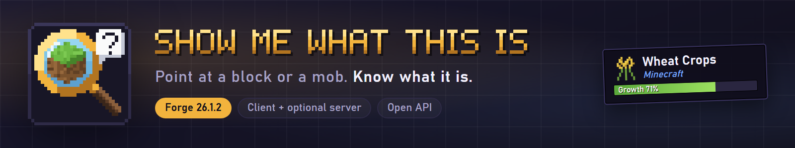
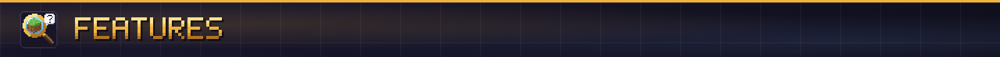
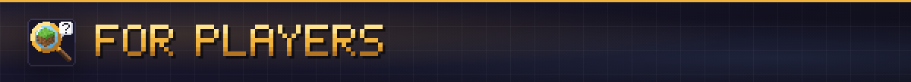
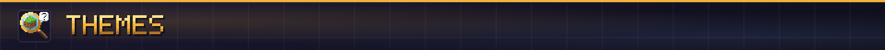
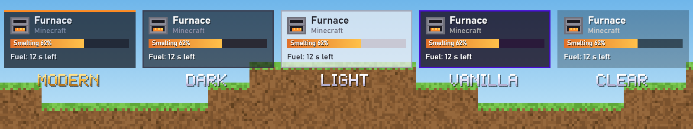
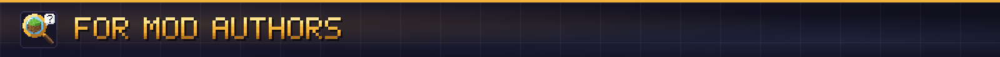
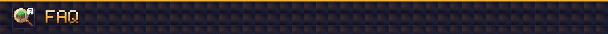

# SMWTI listing kit: CurseForge and Modrinth

Everything you need to fill in the two project forms. Files are in `branding/icon/` and `branding/banners/`.

## Project fields

| Field | CurseForge | Modrinth |
|---|---|---|
| Project ID | 1781438 | CQb1zQ86 (draft, https://modrinth.com/mod/smwti) |
| Name | Show Me What This Is | Show Me What This Is |
| Slug / URL | `show-me-what-this-is` | `smwti` (short), or `show-me-what-this-is` |
| Icon / logo | `icon/icon_512.png` (CurseForge wants square, at least 400x400) | `icon/icon_512.png` (square, under 256 KiB; this one is a few KB) |
| Class | Mods | Mod |
| Main category | Map and Information | Utility |
| More categories | Utility & QoL, API and Library | (none needed) |
| Loader | Forge | Forge |
| Game versions | Set on each uploaded file | Set on each uploaded file |
| Environment | Client, server optional | Client: required, Server: optional |
| License | MIT | MIT |
| Source | https://github.com/ItMeCasey/SMWTI | same |
| Issues | https://github.com/ItMeCasey/SMWTI/issues | same |

### One-line description

> Point at anything in your world and SMWTI tells you what it is, where it came from and what it's up to, from crop growth to chest contents.

Use it anywhere a single sentence fits: the CurseForge summary, social posts, the top of the description.

### Summary

Modrinth (256 characters max):

> A look-at overlay for Forge. Point at a block or a mob to see its name, its mod and its state: crop growth, health, chest contents, machine progress. Other mods add their own lines through a small API.

CurseForge (keep it short; it shows on cards):

> Point at anything in your world and SMWTI tells you what it is, where it came from and what it's up to, from crop growth to chest contents.

### Gallery

| File | Use |
|---|---|
| `banners/features.png` (1920x1080) | Featured gallery image on Modrinth, first image on CurseForge |
| `banners/themes.png` (1920x1080) | The five themes side by side, second gallery image |
| `banners/social.png` (1280x640) | GitHub social preview (repo Settings > Social preview), third gallery image |
| `banners/banner.png` (800x150, saved at 2x) | Top of both descriptions |
| `banners/themes_strip.png` (800x150, saved at 2x) | Themes row inside the descriptions |
| `banners/h_*.png` (800x46, saved at 2x) | Section headers inside the descriptions |

The panels in these images are illustrations drawn for the branding, not game screenshots. Add real in-game screenshots to the gallery once the overlay has been checked in a client.

### Image links in the descriptions

The descriptions below load images from the GitHub repository, so they only show once `branding/` is pushed and the repository is public. If it stays private, upload the images to the project gallery (Modrinth) or Images tab (CurseForge) and swap in those links.

---

## Description (Modrinth, Markdown)

```markdown


**Point at anything in your world and SMWTI tells you what it is, where it came from and what it's up to, from crop growth to chest contents.**

Show Me What This Is (SMWTI) is a look-at overlay for Minecraft Forge. Point at a block or an entity and a small panel tells you what it is, which mod it comes from and, where it can, what state it is in.

It is inspired by Jade and The One Probe and shares no code with them.



- **Every target:** icon, name and the mod it comes from. Looking at water or lava works too.
- **Blocks:** crop and plant growth, redstone power, a note block's note, composter, cauldron, honey and respawn anchor levels, furnace and brewing stand progress, a spawner's mob, a beacon's level, a hive's bees, a jukebox's disc, a flower pot's plant.
- **Containers and machines:** inventories as item icons with counts, fluid tanks and stored energy, sent live by the server.
- **Mobs:** health, armor, active effects with time left, riders and mounts, a horse's speed and jump, a pet's owner, how long a baby takes to grow up or an adult to breed again.
- **Tools:** the tool that breaks the block, with a green check when it's already in your hand.
- **Long form:** sneak to see more, such as the registry id and the block's state.



- Install it on the client. It works on any server; a server that also has SMWTI sends extra live data (chest contents, tank levels, machine progress).
- **F10** turns the overlay on and off, **Ctrl+F10** opens the settings. Both can be rebound in Controls.
- Drag the overlay anywhere on the screen from the settings (**Move overlay...**). It snaps to centers and corners and stays clear of the hotbar.
- Resource packs can hide, rename or add lines to any block or entity with a small JSON file.



Five themes: modern (the default), dark, light, vanilla and clear. Pick one in the settings and set how see-through the backdrop is.





Add your own lines through `SmwtiApi`: client and server providers for blocks and entities, progress bars, item icons, name and icon overrides, block redirects for multiblocks, custom drawn elements, and settings that show up in the SMWTI settings screen. The API is shaped like Jade's, so porting a Jade plugin is mostly renaming. See the [README](https://github.com/ItMeCasey/SMWTI#for-mod-authors) for examples.



**Does it need to be on the server?** No. On a server without it you still get names, mods, growth, health and everything the client can see. Install it on the server too for container contents and machine data.

**Does it load Jade or The One Probe plugins?** No. Mods add support through SMWTI's own API.

**Other loaders?** Forge only for now. The Files tab lists the Minecraft versions each release supports.

**License:** MIT. Source and issues on [GitHub](https://github.com/ItMeCasey/SMWTI).
```

## Description (CurseForge)

The current CurseForge description is in [`curseforge/DESCRIPTION.md`](../curseforge/DESCRIPTION.md). It's newer than the Modrinth text above: it adds the hide key, compact mode, hold-to-show, pack themes, plugins and wiki links. Paste it with the description type set to **Markdown**.

---

## Checklist

1. Push `branding/` to GitHub (and make the repository public) so the description images load.
2. Create the Modrinth project: name, slug, summary, icon, categories, environment, license, links, description. Upload `features.png` as the featured gallery image.
3. Create the CurseForge project the same way, with `icon_512.png` as the logo. CurseForge reviews new projects before they go live, so it needs a first file uploaded.
4. Set `banners/social.png` as the GitHub social preview.
5. Optional: add `icon/smwti_logo.png` to the jar as the Forge mod list logo (`logoFile="smwti_logo.png"` in `mods.toml`, file in `src/main/resources/`).
