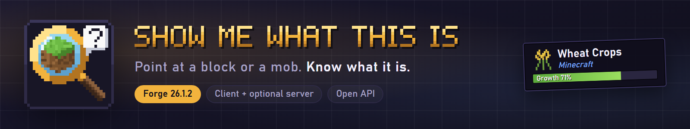
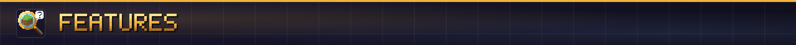
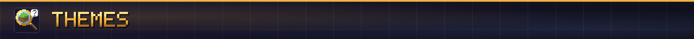
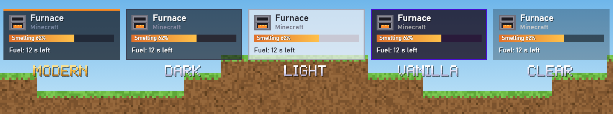
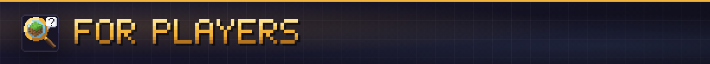
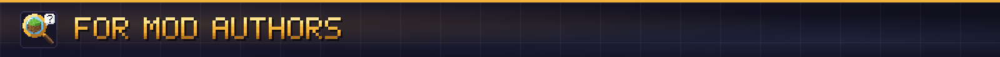
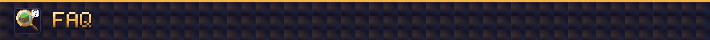

**Point at anything in your world and SMWTI tells you what it is, where it came from and what it's up to, from crop growth to chest contents.**

Show Me What This Is (SMWTI) is a look-at overlay for Minecraft Forge and NeoForge. Point at a block or a creature and a small panel tells you what it is, which mod it comes from and what state it's in. It's inspired by Jade and The One Probe and shares no code with them.

**Full guide:** [itmecasey.com/wiki/smwti](https://itmecasey.com/wiki/smwti/)

- **Every target:** its icon, name and mod, plus a tool badge beside the name: a green check when you hold the right tool, a red cross when the block would drop nothing without it. Water and lava count too.
- **Blocks:** crop growth, redstone power, composter, cauldron, hive and respawn anchor levels, furnace and brewing progress, a spawner's mob and countdown, a beacon's level and effects, enchanting power, sign text, lecterns, campfires, jukeboxes, flower pots, heads, locked hoppers, unstable TNT and waxed blocks.
- **Containers and machines:** what's inside as item icons with counts, fluid tanks and stored energy, sent live by the server.
- **Creatures:** health, armor, equipment, active effects with time left, riders and mounts, a horse's speed and jump, a villager's job and level, a pet's owner, how long a baby takes to grow up, and the next egg a chicken lays.
- **Long form:** sneak to see more, such as the registry id, the block's state, the tool tier it needs and its hardness.

Five built-in themes (modern, dark, light, vanilla and clear), an adjustable backdrop, and **your own themes from a resource pack**. [How to make one](https://itmecasey.com/wiki/smwti/?p=themes#make-your-own-theme).

- **F10** turns the overlay on and off. **Ctrl+F10** opens the settings. **Shift+F10** hides whatever you're looking at, with a list in the settings to bring things back.
- **Drag the panel anywhere.** It snaps to centers and corners and stays clear of your hotbar.
- Compact mode, hold-to-show (Left Alt), size, and a long form that shows while sneaking, always or never.
- Resource packs can hide, rename or add lines to any block or creature.
- With ModJS, client scripts can add, rename or hide lines and read what the overlay shows.
- Works from the client alone on any server. With the mod on the server too, it also shows container contents, tanks, energy and machine progress. Server owners can shorten the reach, keep inventories private and block things from being shown.

Add your own lines with a **plugin**: mark a class `@SmwtiPlugin` and SMWTI finds it on its own, with no hard dependency. Show bars, item grids, progress, custom names and icons, redirects for multiblocks, and your own settings. It's shaped like Jade's API, so porting is mostly renaming.

[Make your own plugin](https://itmecasey.com/wiki/smwti/?p=make-a-plugin) · [Plugin reference](https://itmecasey.com/wiki/smwti/?p=plugin-reference)

**Does it need to be on the server?** No. Without it on the server you still get names, mods, growth, health and everything the client can see.

**Does it load Jade or The One Probe plugins?** No. Mods add support through SMWTI's own plugins.

**Can I use it in my modpack?** Yes. It's MIT licensed.

Source and issues on [GitHub](https://github.com/ItMeCasey/SMWTI).
